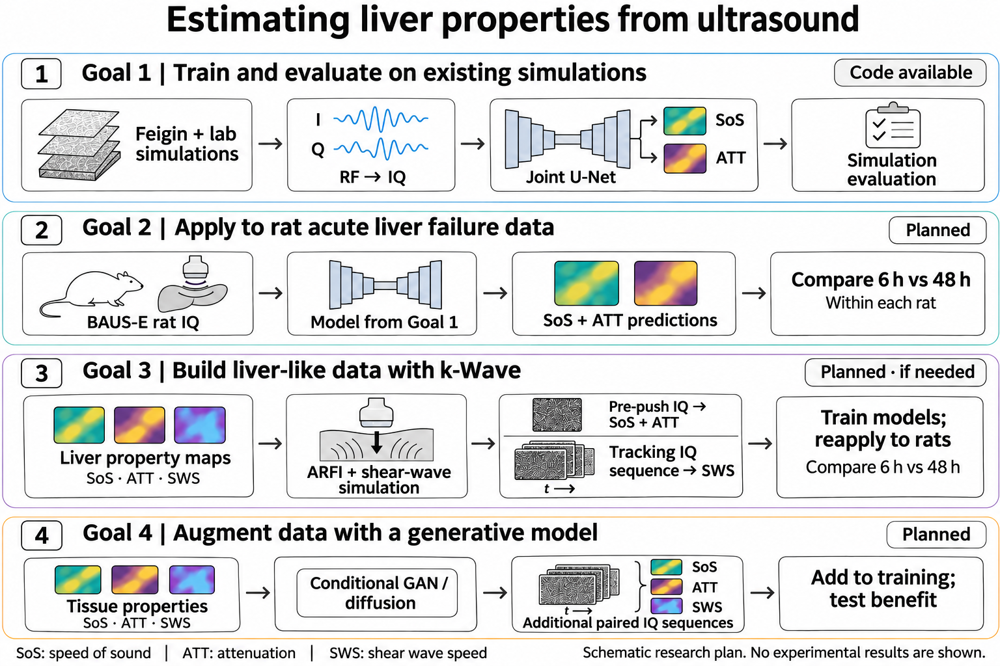
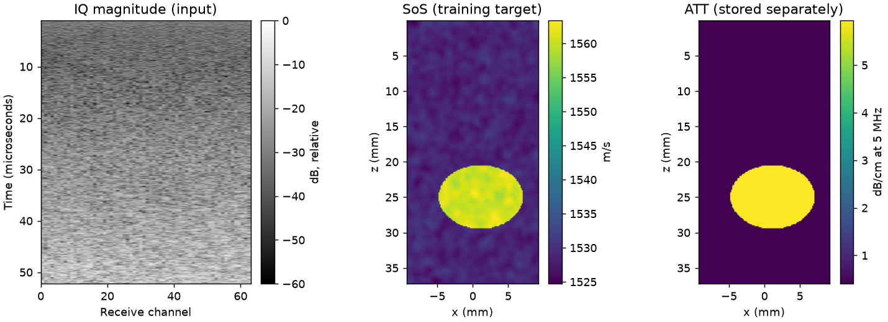

# Estimating Liver Properties from Ultrasound

## Research outline

This project develops AI models that estimate tissue properties from ultrasound IQ data. We will test whether the predictions distinguish stages of acute liver injury in a rat model of acute liver failure (ALF). We will first train a model to estimate speed of sound (SoS) and attenuation (ATT) together using existing simulation data. If needed, we will add a module to estimate shear wave speed (SWS). We will train this module on synthetic data that resemble liver tissue.

Related study: [Wearable bioadhesive ultrasound shear wave elastography](https://doi.org/10.1126/sciadv.adk8426), Liu et al., *Science Advances*, 2024.



### Goal 0 — Learn the basics and review the research

- Study [Stanford CS231n: Deep Learning for Computer Vision](https://cs231n.stanford.edu/2025/) using the [lecture videos](https://www.youtube.com/watch?v=2fq9wYslV0A) and [course materials](https://cs231n.stanford.edu/2025/schedule.html). Learn about tensors, backpropagation, CNNs, regression, and how to split a dataset. Practice NumPy basics and complete the [PyTorch exercises](https://cs231n.github.io/assignments2025/assignment2/).
- Watch **Lectures 1–8 and 12–14** first. They provide enough background to begin this project.
- Read [Computing Speed-of-Sound From Ultrasound: User-Agnostic Recovery and a New Benchmark](https://doi.org/10.1109/TBME.2023.3327147). Learn how to acquire data, preprocess ultrasound signals, and train a model to estimate SoS. Explore the [paper's code](https://huggingface.co/laughingrice/dl_us_sos_inversion/tree/main).
- Read the BAUS-E paper to understand how the rat ALF data were collected.

### Goal 1 — Train and evaluate on simulation data

Train a U-Net on [Feigin simulations](https://doi.org/10.1109/TBME.2023.3327147) ([dataset](https://huggingface.co/datasets/laughingrice/Ultrasound_planewave_sos_inversion)) and QUASOS-based simulations generated in our lab ([setup reference](https://qulab.medphysics.wisc.edu/ieee-tuffc-quasos-challenge/)). Use IQ inputs to estimate SoS and ATT maps together. Evaluate the model on simulation data.

**RF → IQ → U-Net → SoS and ATT maps**

### Goal 2 — Apply the model to data from rats with ALF

Prepare the ultrasound data from the BAUS-E rat ALF study. Apply the SoS/ATT model trained in Goal 1. Compare its predictions at **6 and 48 hours after d-galactosamine injection** to test whether they distinguish stages of acute liver injury.

- Evaluate how well SoS and ATT each distinguish the two time points.
- Analyze changes within each rat.
- Use the studies on acute liver injury and hepatitis in the references to explain why SoS and ATT are worth testing.

### Goal 3 — Generate synthetic liver data with k-Wave and estimate three properties

Use k-Wave to generate synthetic data that resemble liver tissue. Train models on these data to estimate **SoS, ATT, and SWS**, then apply them to the rat ALF data again.

- Build liver phantoms with a range of SoS, ATT, SWS, and viscoelastic properties. Simulate an acoustic radiation force impulse (ARFI) push and the resulting shear waves. Use the tissue motion to generate RF/IQ sequences. Match the probe and acquisition settings to the supplied BAUS-E data.
- Train and evaluate the models using the simulated IQ data and their property maps. Use IQ acquired before the push for SoS and ATT. Use the IQ time sequence that tracks the shear wave for SWS.
- Apply the trained models to the rat data again. Compare each property's predictions at 6 and 48 hours. Assess what SWS adds to the SoS/ATT results from Goal 2.

### Goal 4 — Augment the data with a generative model

- Train a GAN or diffusion model that generates additional IQ data conditioned on **SoS, ATT, and SWS** maps. Generate motion-tracking IQ sequences for SWS estimation. Add the generated samples to the training set and test whether they improve estimation of all three properties.
- Use synthetic data to address the shortage of training data. Test whether this reduces the need to collect large datasets from real tissue.

## Repository guide

This repository provides example code for **Goal 1**. It covers data preparation, U-Net training, inference, and evaluation for joint SoS/ATT estimation. Goals 2–4 describe planned extensions: applying the models to rat data, generating synthetic liver data with k-Wave to estimate three properties, and augmenting the data with generative models.

Use Google Colab for small training exercises for now. The lab GPU has been ordered. Once it arrives, I will set up the environment and use it for most model training. Until then, focus on the background knowledge and learn the code through simple exercises.

- `scripts/`: model, training, inference, evaluation, and data utilities.
- `configs/unet.json`: training settings.
- `data/processed/quasos/`: prepared lab simulations and a manifest that defines the data splits.

### Data

| Source | Train / validation / test | Access |
|---|---|---|
| Lab simulations | 92 / 23 / 23 | Included in `data/processed/quasos/` (about 226 MB) |
| Feigin, 5 MHz | 9,216 / 1,024 / 1,024 | [Public download](https://huggingface.co/datasets/laughingrice/Ultrasound_planewave_sos_inversion). Allow about 300 GB for raw and prepared data. |

Each lab NPZ file contains the arrays below, plus coordinates and acquisition metadata. `manifest.jsonl` assigns each scene to a fixed train, validation, or test split.

| Field | Shape | Meaning |
|---|---|---|
| `rf` | `[2048,64]` | Time samples × receive channels. A 0° plane-wave crop with the central 64 receive channels. |
| `iq` | `[2,2048,64]` | I/Q × time samples × receive channels. Model input. |
| `sos` | `[256,128]` | Depth × lateral position, in m/s. Training target. |
| `att` | `[256,128]` | Attenuation at 5 MHz, in dB/cm. Training target. |



The U-Net outputs two maps in **SoS, ATT** channel order, with shape `[B,2,256,128]`. We standardize each property using the mean and standard deviation of its training maps. This puts their errors on comparable scales. The loss gives equal weight to the L1 errors for the two standardized properties. During training, we sample the Feigin and lab datasets with equal probability.

We select the checkpoint using validation data. We divide each property's MAE by its training standard deviation, then average the scores with equal weight for both properties and both datasets. We keep the checkpoint with the lowest score.

### Train

```bash
python -m venv .venv
source .venv/bin/activate
python -m pip install -e .

python -m scripts.util download --out data/raw/feigin
python -m scripts.util feigin --raw data/raw/feigin --out data/processed/feigin
python -m scripts.util merge \
  --manifests data/processed/feigin/manifest.jsonl data/processed/quasos/manifest.jsonl \
  --out data/processed/manifest.jsonl

python -m scripts.train --manifest data/processed/manifest.jsonl \
  --config configs/unet.json --out outputs/unet --device auto
```

For CUDA, install the appropriate [PyTorch build](https://pytorch.org/get-started/locally/) for your environment.

### Infer and evaluate

```bash
python -m scripts.infer \
  --input data/processed/quasos/cases/train-dataset__D10_A_L115_002.npz \
  --checkpoint outputs/unet/best.pt --out outputs/example --device auto

python -m scripts.evaluate --manifest data/processed/manifest.jsonl \
  --checkpoint outputs/unet/best.pt --split test --out outputs/test --device auto
```

Inference saves `sos_prediction_m_s.npy` and `att_prediction_db_cm.npy`. It also saves a PNG with the predictions and, when references are available, the reference maps and errors. Evaluation reports MAE, RMSE, and bias separately for SoS (m/s) and ATT (dB/cm at 5 MHz).

## References

1. Liu et al. (2024). [Wearable bioadhesive ultrasound shear wave elastography](https://doi.org/10.1126/sciadv.adk8426). *Science Advances*. The BAUS-E study of ALF in rats.
2. Matsuhashi et al. (1996). [An evaluation of hepatic ultrasound speed in injury models in rats: correlation with tissue constituents](https://doi.org/10.7863/jum.1996.15.8.563). *Journal of Ultrasound in Medicine*. Reports SoS differences in a model of acute liver injury.
3. Steinmann et al. (2023). [Accuracy of controlled attenuation parameter measurement for the detection of steatosis in autoimmune liver diseases](https://doi.org/10.1016/j.jhepr.2023.100898). *JHEP Reports*. Reports changes in the controlled attenuation parameter (CAP) as liver inflammation resolves.
4. [Correlation of gallbladder wall pathology with controlled attenuation parameter, liver stiffness measurement, and laboratory markers in acute viral hepatitis A](https://doi.org/10.1177/1742271X251356613) (2025). Reports CAP differences associated with gallbladder wall thickening in acute hepatitis A.
5. [Computing Speed-of-Sound From Ultrasound: User-Agnostic Recovery and a New Benchmark](https://doi.org/10.1109/TBME.2023.3327147).
6. [IQ-JEPA: A Joint-Embedding Predictive Architecture with a Hermitian Vision Transformer for Sound Speed and Attenuation Estimation from Ultrasound IQ Data](https://arxiv.org/abs/2607.22351).
7. [QUASOS Challenge: Quantitative Ultrasound Estimation of Attenuation and Speed-of-Sound](https://qulab.medphysics.wisc.edu/ieee-tuffc-quasos-challenge/).
8. Prieur and Catheline. [Simulation of shear wave elastography imaging using the toolbox “k-Wave”](https://doi.org/10.1121/2.0000398).
9. Delaunay et al. (2022). [An unsupervised learning-based shear wave tracking method for ultrasound elastography](https://doi.org/10.1117/12.2612200).
