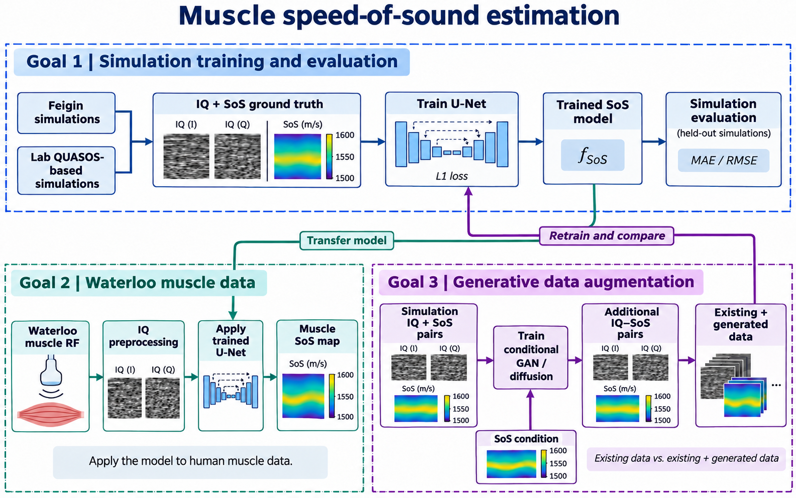

# Muscle Speed-of-Sound Estimation

## Research outline

This research aims to develop an AI model for muscle quality assessment (disability related topic). The model estimates spatial speed of sound (SoS) from ultrasound IQ data.

Related study: [Detecting Muscle Activation Using Ultrasound Speed of Sound Inversion with Deep Learning](https://arxiv.org/abs/1910.09046).



### Goal 0 — Deep learning and research preparation

- Study [Stanford CS231n: Deep Learning for Computer Vision](https://cs231n.stanford.edu/2025/) ([lecture videos](https://www.youtube.com/watch?v=2fq9wYslV0A), [notes](https://cs231n.stanford.edu/2025/schedule.html)) to understand tensors, backpropagation, CNNs, regression, and dataset splits. The course starts with NumPy and includes [PyTorch exercises](https://cs231n.github.io/assignments2025/assignment2/).
- Watch Lectures **1–8 and 12–14** first. These provide sufficient background to begin this project.
- Read [Computing Speed-of-Sound From Ultrasound: User-Agnostic Recovery and a New Benchmark](https://doi.org/10.1109/TBME.2023.3327147) (see also the references below) to understand how to acquire data, preprocess ultrasound signals, and train a model for SoS estimation. You can also check the [paper's code](https://huggingface.co/laughingrice/dl_us_sos_inversion/tree/main).

### Goal 1 — Simulation training and evaluation

Train a U-Net on [Feigin simulations](https://doi.org/10.1109/TBME.2023.3327147) ([dataset](https://huggingface.co/datasets/laughingrice/Ultrasound_planewave_sos_inversion)) and lab-generated QUASOS-based simulations ([QUASOS setup reference](https://qulab.medphysics.wisc.edu/ieee-tuffc-quasos-challenge/)). Estimate spatial SoS maps from IQ inputs and evaluate the model on simulation data.

**RF → IQ → U-Net → spatial SoS**

### Goal 2 — Application to Waterloo muscle data

Obtain the [Waterloo muscle dataset](https://huggingface.co/datasets/nvidia/Open-H-RF/tree/main/waterloo-muscle) ([dataset guide](https://github.com/open-h/Open-H-RF/tree/main/datasets/waterloo-muscle)). Prepare the inputs and use the model to estimate SoS in human muscles.

### Goal 3 — Generative data augmentation

Train a SoS-conditioned GAN or diffusion model that generates additional RF/IQ data directly. Add the generated data to the training dataset and test whether SoS estimation improves.

## Repository guide

This repository provides example code for **Goal 1**: simulation data preparation, U-Net training, inference, and evaluation.

Use Google Colab for small training exercises for now. The lab GPU has been ordered. Once it arrives, I will set up the environment and use it for most model training. Until then, focus on the knowledge needed for this research and learn the code through simple exercises.

- `scripts/`: model, training, inference, evaluation, and data utilities.
- `configs/unet.json`: training settings.
- `data/processed/quasos/`: prepared lab simulation samples and split manifest.

### Data

| Source | Train / validation / test | Access |
|---|---|---|
| Lab simulations | 92 / 23 / 23 | Included in `data/processed/quasos/` (~226 MB) |
| Feigin, 5 MHz | 9,216 / 1,024 / 1,024 | [Public download](https://huggingface.co/datasets/laughingrice/Ultrasound_planewave_sos_inversion); allow ~300 GB for raw + prepared data |

Each lab NPZ contains the following arrays plus coordinates and acquisition metadata. `manifest.jsonl` defines fixed scene splits.

| Field | Shape | Meaning |
|---|---|---|
| `rf` | `[2048,64]` | Time × RX; 0° plane-wave crop, central 64 RX |
| `iq` | `[2,2048,64]` | I/Q × time × RX; model input |
| `sos` | `[256,128]` | Depth × lateral, m/s; training target |
| `att` | `[256,128]` | dB/cm at 5 MHz; stored separately |


### Train

```bash
python -m venv .venv
source .venv/bin/activate
python -m pip install -e .

python -m scripts.util download --out data/raw/feigin
python -m scripts.util feigin --raw data/raw/feigin --out data/processed/feigin
python -m scripts.util merge \
  --manifests data/processed/feigin/manifest.jsonl data/processed/quasos/manifest.jsonl \
  --out data/processed/manifest.jsonl

python -m scripts.train --manifest data/processed/manifest.jsonl \
  --config configs/unet.json --out outputs/unet --device auto
```

For CUDA, use the appropriate [PyTorch build](https://pytorch.org/get-started/locally/).

### Infer and evaluate

```bash
python -m scripts.infer \
  --input data/processed/quasos/cases/train-dataset__D10_A_L115_002.npz \
  --checkpoint outputs/unet/best.pt --out outputs/example --device auto

python -m scripts.evaluate --manifest data/processed/manifest.jsonl \
  --checkpoint outputs/unet/best.pt --split test --out outputs/test --device auto
```

Inference saves a SoS NPY and GT/prediction/error PNG. Evaluation reports MAE, RMSE, and bias in m/s.

## References

1. [Detecting Muscle Activation Using Ultrasound Speed of Sound Inversion with Deep Learning](https://arxiv.org/abs/1910.09046)
2. [Live Pulse-Echo Speed-of-Sound Estimation for Quality Assessment of Large Muscles in Humans](https://doi.org/10.1016/j.ultrasmedbio.2025.06.013)
3. [Computing Speed-of-Sound From Ultrasound: User-Agnostic Recovery and a New Benchmark](https://doi.org/10.1109/TBME.2023.3327147)
4. [IQ-JEPA: A Joint-Embedding Predictive Architecture with a Hermitian Vision Transformer for Sound Speed and Attenuation Estimation from Ultrasound IQ Data](https://arxiv.org/abs/2607.22351)
5. [QUASOS Challenge: Quantitative Ultrasound Estimation of Attenuation and Speed-of-Sound](https://qulab.medphysics.wisc.edu/ieee-tuffc-quasos-challenge/)
